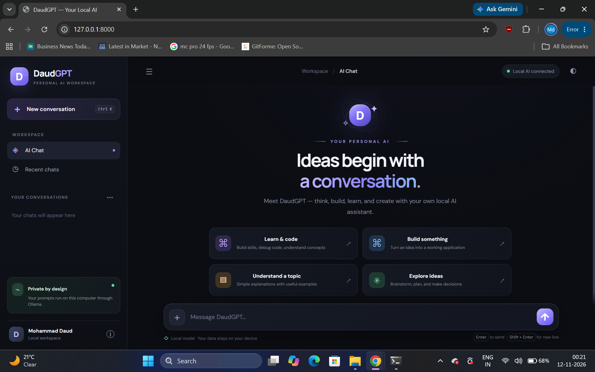
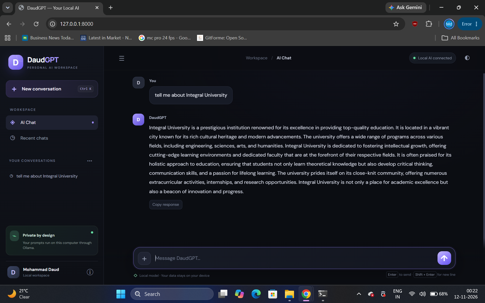
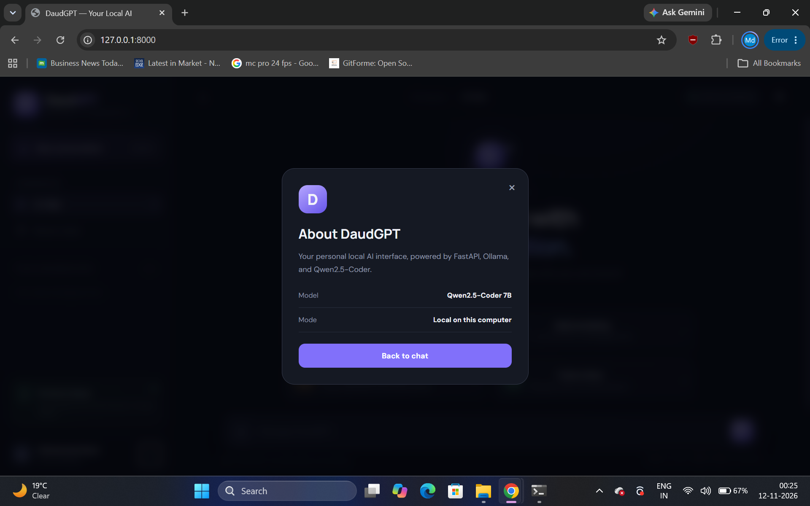

<<<<<<< HEAD

\# DaudGPT Pro 🤖

A locally running AI chatbot powered by Python, FastAPI, and Ollama.

\## 🚀 Features

\- AI-powered conversational chatbot

\- Local AI inference using Ollama

\- Qwen2.5 1.5B model integration

\- Chat history support

\- Ollama connection status

\- Available model detection

\- Responsive web interface

\## 🛠️ Tech Stack

\- Python

\- FastAPI

\- HTML

\- CSS

\- JavaScript

\- Ollama

\- Qwen2.5 1.5B

\## 📁 Project Structure

DaudGPT\_Pro/

├── main.py

├── requirements.txt

├── README.md

├── .gitignore

└── static/

&#x20;   ├── index.html

&#x20;   ├── style.css

&#x20;   └── app.js

\## ⚙️ Installation

\### 1. Clone the repository

git clone https://github.com/md-daud/DaudGPT-Pro.git

cd DaudGPT-Pro

\### 2. Install dependencies

pip install -r requirements.txt

\### 3. Install Ollama

Download Ollama from:

https://ollama.com/

\### 4. Download the AI model

ollama pull qwen2.5:1.5b

\### 5. Run the application

uvicorn main:app --reload

\### 6. Open in browser

http://127.0.0.1:8000

\## 🧠 AI Engine

DaudGPT Pro uses Ollama to run the Qwen2.5 1.5B

language model locally.

\## 👨‍💻 Developer

Mohammad Daud

GitHub:

https://github.com/md-daud

\## 📜 License

License not specified yet.

---

## 📸 Application Screenshots

### 🏠 Home Page

### 💬 AI Chat Interface

### 🤖 AI Model Status

# DaudGPT-Pro
AI-powered chatbot using Python and Ollama

